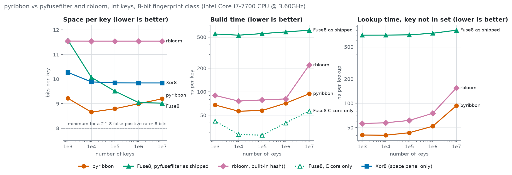
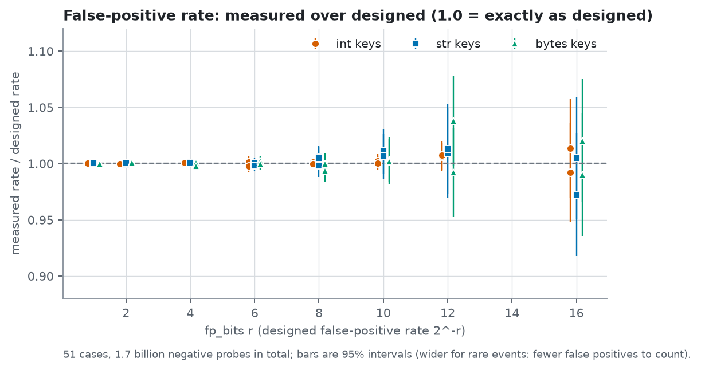

# pyribbon

[](https://github.com/Zikithezikit/pyribbon/actions/workflows/ci.yml)

Ribbon filters for Python. A ribbon filter answers "is this key in the set?" for a fixed set of keys. It never says
"no" for a key that is in the set. For a key that is not, it says "yes" with a probability you choose (`2**-fp_bits`).
It needs fewer bits per key than a Bloom filter at the same false-positive rate. The core is C11, the Python layer is a
thin extension, and there are no runtime dependencies. The C core also builds on its own, without Python;
[core/README.md](https://github.com/Zikithezikit/pyribbon/blob/main/core/README.md) explains how to use it.

Build a filter from your keys with `RibbonFilter(keys)` and ask it with `key in f`. [examples/01_quickstart.py](https://github.com/Zikithezikit/pyribbon/blob/main/examples/01_quickstart.py)
is the shortest complete program.

Space, build time and lookup time against the number of keys, measured on one machine against `pyfusefilter` and `rbloom`
(lower is better in every panel; the numbers behind the plots, and the caveats, are under How it compares):



## Install

```bash
pip install pyribbon
```

It needs Python 3.10 or newer. Wheels are published for Linux (x86-64 and ARM, glibc and musl), macOS (Intel and Apple
silicon) and Windows (x64). On any other platform pip builds the source distribution, and a C compiler is the only build
requirement. To install from a checkout instead, run `pip install .` in it.

## Examples

Start with `01_quickstart.py` and read them in order. Each script in [`examples/`](https://github.com/Zikithezikit/pyribbon/tree/main/examples) runs on its own
(`python examples/01_quickstart.py`), and `make example` runs them all.

| Script | What it shows |
|---|---|
| [01_quickstart.py](https://github.com/Zikithezikit/pyribbon/blob/main/examples/01_quickstart.py) | Build a filter, ask it about keys, look at its size |
| [02_key_types.py](https://github.com/Zikithezikit/pyribbon/blob/main/examples/02_key_types.py) | Which keys are accepted and how `b"a"`, `"a"` and `97` stay different |
| [03_choosing_fp_bits.py](https://github.com/Zikithezikit/pyribbon/blob/main/examples/03_choosing_fp_bits.py) | Designed against measured false-positive rate, and the cost in bits |
| [04_save_and_load.py](https://github.com/Zikithezikit/pyribbon/blob/main/examples/04_save_and_load.py) | `to_bytes`, loading from a memory-mapped file, and a damaged file |
| [05_batches_and_arrays.py](https://github.com/Zikithezikit/pyribbon/blob/main/examples/05_batches_and_arrays.py) | `contains_many` with lists, `array.array` and numpy |
| [06_errors.py](https://github.com/Zikithezikit/pyribbon/blob/main/examples/06_errors.py) | Every error a caller can get, and what causes it |
| [07_threads.py](https://github.com/Zikithezikit/pyribbon/blob/main/examples/07_threads.py) | Querying one filter from several threads |

## Usage

### Keys

A key can be `bytes`, `bytearray` or `memoryview` (hashed by content), `str` (as UTF-8) or `int` (any size; `numpy`
integers work). `b"a"`, `"a"` and `97` are three different keys. Anything else, such as a `float`, `None` or a tuple,
raises `TypeError`, because there is no implicit `str()`. Python's `hash()` is never used, so a saved filter can be loaded
in any process on any platform. `DESIGN.md` (section 3.1) specifies the exact mapping. [examples/02_key_types.py](https://github.com/Zikithezikit/pyribbon/blob/main/examples/02_key_types.py) tries each case.

### Choosing `fp_bits`

The false-positive rate is `2**-fp_bits`, with `fp_bits` from 1 to 32 (default 8). The table below was measured on this
project's test machine at 1,000,000 keys and includes the 64-byte header. A Bloom filter needs `1.44 * fp_bits` bits per
key.

| `fp_bits` | false-positive rate | bits per key |
|---:|---:|---:|
| 4 | 6.25% | 4.50 |
| 8 | 0.39% | 8.99 |
| 12 | 0.024% | 13.49 |
| 16 | 0.0015% | 17.99 |
| 20 | 0.000095% | 22.48 |

The measured false-positive rate matches the designed one. Each dot below is one test case (int, `str` and `bytes` keys,
`fp_bits` 1 to 16, up to 100 million negative probes each); `docs/measurements.md` lists them all.



[examples/03_choosing_fp_bits.py](https://github.com/Zikithezikit/pyribbon/blob/main/examples/03_choosing_fp_bits.py) measures the rate and the size for a few values of `fp_bits` on
your own machine.

### Saving and loading

`to_bytes()` produces a versioned, little-endian format with a magic number and checksums. `from_buffer()` queries the
bytes where they are, without copying them, so a memory-mapped file uses no memory beyond the pages you touch:

The whole round trip, including a memory-mapped file and a damaged one, is in
[examples/04_save_and_load.py](https://github.com/Zikithezikit/pyribbon/blob/main/examples/04_save_and_load.py).

`from_buffer(buf, verify=False)` skips the payload checksum, which would read every byte, so a huge mapped file stays
lazy. The header is always validated. The loader treats its input as untrusted: a truncated, corrupted or hostile buffer
raises `FormatError` (a `ValueError`) and is never read outside its bounds. The checksum detects accidental corruption
only. It is not a MAC, so it does not protect against tampering. Do not modify a buffer while a filter is using it.

### Batches and arrays

`contains_many(keys)` returns a `list[bool]`. A 1-D integer buffer (`array.array`, `numpy`) is hashed in C without the
GIL, and gives exactly the same results as querying the same ints one at a time:

[examples/05_batches_and_arrays.py](https://github.com/Zikithezikit/pyribbon/blob/main/examples/05_batches_and_arrays.py) shows both, with and without numpy.

### Errors

A build that finds no solvable system after `max_attempts` seeds raises `ConstructionError`; it never returns a broken
filter. Bad serialized data raises `FormatError`. Both are subclasses of `RibbonError`. Invalid arguments raise
`ValueError` or `TypeError`.

[examples/06_errors.py](https://github.com/Zikithezikit/pyribbon/blob/main/examples/06_errors.py) triggers each of them.

### Threads

A filter is immutable, so any number of threads can query the same filter at once. Builds and large batches release the
GIL. `pickle` and `copy` work. The free-threaded builds of CPython (3.14t and 3.15t) have their own wheels, and importing
the extension there leaves the GIL off. [examples/07_threads.py](https://github.com/Zikithezikit/pyribbon/blob/main/examples/07_threads.py) queries one
filter from eight threads.


## How it compares

The tables in this section come from `make bench` and are copied in by `benchmarks/update_readme.py`; a test fails if a
number here differs from the report. `docs/benchmark.md` has the machine description, method, medians, spreads and
caveats, `docs/benchmark.json` the raw data. The figure above comes from `benchmarks/make_figures.py`; the full six-panel plot is
[docs/benchmark.png](https://github.com/Zikithezikit/pyribbon/blob/main/docs/benchmark.png). The baselines are `pyfusefilter` (Xor8,
Xor16, Fuse8 and Fuse16; it is the maintained successor of `pyxorfilter`) and `rbloom` (a Bloom filter). All numbers come
from one machine (an i7-7700, CPython 3.14), pinned to one core.

The first table summarises the largest size, comparing pyribbon with the best other filter of the same fingerprint width:

<!-- bench:start -->
*Where pyribbon wins and loses (int keys, n = 10,000,000):*

| Class | Metric | pyribbon | Best other | Delta | Verdict |
| --- | --- | ---: | ---: | ---: | ---: |
| 8-bit | bits/key | 9.19 | 9.02 (Fuse8) | +2% | **pyribbon behind** |
| 8-bit | bits/key above log2(1/FPR) | 1.18 | 1.00 (Fuse8) | +17% | **pyribbon behind** |
| 8-bit | build ns/key | 94 | 219 (rbloom 2^-8, builtin hash()) | -57% | pyribbon ahead |
| 8-bit | `in` member ns | 91 | 229 (rbloom 2^-8, builtin hash()) | -60% | pyribbon ahead |
| 8-bit | `in` non-member ns | 93 | 155 (rbloom 2^-8, builtin hash()) | -40% | pyribbon ahead |
| 8-bit | batch Mkeys/s (50/50 mix) | 18.04 | 5.01 (rbloom 2^-8, builtin hash()) | +260% | pyribbon ahead |
| 16-bit | bits/key | 18.39 | 18.04 (Fuse16) | +2% | **pyribbon behind** |
| 16-bit | bits/key above log2(1/FPR) | 2.36 | 1.95 (Fuse16) | +21% | **pyribbon behind** |
| 16-bit | build ns/key | 109 | 441 (rbloom 2^-16, builtin hash()) | -75% | pyribbon ahead |
| 16-bit | `in` member ns | 138 | 431 (rbloom 2^-16, builtin hash()) | -68% | pyribbon ahead |
| 16-bit | `in` non-member ns | 113 | 169 (rbloom 2^-16, builtin hash()) | -33% | pyribbon ahead |
| 16-bit | batch Mkeys/s (50/50 mix) | 10.81 | 3.24 (rbloom 2^-16, builtin hash()) | +234% | pyribbon ahead |

Delta is relative to the best other filter of the same fingerprint class, including rbloom with its builtin `hash()`; a negative delta means pyribbon is lower. Lower is better except for batch throughput. The 'above log2(1/FPR)' rows move with the measured FPR, whose uncertainty is in the notes. The batch row compares `contains_many` with the other libraries' per-key loop, because none of them has a batch API. The table is computed from the raw results of this run.
<!-- bench:end -->

The next tables show how the results change with the number of keys:

<!-- bench-by-size:start -->
*Space, 8-bit class (bits per key including the 64-byte header; last column: pyribbon relative to Fuse8):*

| n | pyribbon | Xor8 | Fuse8 | rbloom 2^-8 | pyribbon vs Fuse8 |
|---:|---:|---:|---:|---:|---:|
| 1,000 | 9.22 | 10.27 | 11.58 | 11.54 | -20.4% |
| 10,000 | 8.65 | 9.88 | 10.07 | 11.54 | -14.0% |
| 100,000 | 8.79 | 9.84 | 9.51 | 11.54 | -7.5% |
| 1,000,000 | 8.99 | 9.84 | 9.04 | 11.54 | -0.6% |
| 10,000,000 | 9.19 | 9.84 | 9.02 | 11.54 | +2.0% |

*Build time (ns per key). `pyfusefilter` as shipped hashes every key in Python; the last column is its bare C core on pre-hashed keys, which is what a C-to-C comparison would use:*

| n | pyribbon (Python keys) | Fuse8 as shipped | Fuse8 C core only |
|---:|---:|---:|---:|
| 1,000 | 68 | 549 | 42 |
| 10,000 | 56 | 529 | 28 |
| 100,000 | 57 | 555 | 28 |
| 1,000,000 | 71 | 582 | 40 |
| 10,000,000 | 94 | 613 | 57 |

*Query: `key in f` in ns (member / non-member) and `contains_many` throughput (million keys per second, 50/50 mix, from a list and from an `array('q')`):*

| n | pyribbon `in` | Fuse8 `in` | pyribbon batch (list) | pyribbon batch (array) |
|---:|---:|---:|---:|---:|
| 1,000 | 46 / 40 | 685 / 698 | 21.9 | 30.7 |
| 10,000 | 46 / 40 | 727 / 699 | 22.1 | 30.7 |
| 100,000 | 47 / 43 | 729 / 705 | 21.0 | 28.9 |
| 1,000,000 | 54 / 52 | 728 / 737 | 21.0 | 28.6 |
| 10,000,000 | 91 / 93 | 806 / 804 | 18.0 | 24.0 |
<!-- bench-by-size:end -->

On space, pyribbon is the smallest filter up to about a hundred thousand keys, roughly level with Fuse8 at a million, and
slightly larger than Fuse8 at ten million. With width 64 the overhead grows with the logarithm of the set size. It stays
well below a Bloom filter at every size.

Building from Python keys, pyribbon is several times faster than `pyfusefilter` as shipped, because that package hashes
every key in Python. That says something about the Python wrapper, not the algorithm: on pre-hashed keys the bare C core
of Fuse8 builds faster than pyribbon's elimination (last column of the build table). pyribbon also builds faster than
`rbloom` here, which calls Python's `hash()` per key.

`key in f` takes tens of nanoseconds in the C extension, and a good part of that is the interpreter's call overhead.
`pyfusefilter` goes through `cffi` and hashes in Python. The batch API, especially with an integer array, avoids most of
the per-key interpreter cost.

The caveats are in `docs/benchmark.md`. The numbers come from one machine with a `powersave` governor, so absolute
figures do not transfer, only the comparisons within a run. The baselines are measured as shipped, including the
Python-side hashing they do.

## How it works

Each key becomes one linear equation over GF(2) with a window of 64 consecutive unknowns. The unknowns are `r`-bit rows,
chosen so that every key's equation holds. A query XORs the rows its equation selects and compares the result with the
key's `r`-bit fingerprint. Building is banded Gaussian elimination. If a random key set happens to be unsolvable (a few
percent of attempts at the default size), the build retries with a new seed.

The design is the standard Ribbon filter of Dillinger and Walzer, "Ribbon filter: practically smaller than Bloom and Xor"
(arXiv:2103.02515), with width 64 and the interleaved column layout. `RESEARCH.md` has the literature survey and
`DESIGN.md` the decisions, formats and measurements behind this implementation. The C core builds and tests without
Python (`make -C core test`).

## Limits

* A filter is static: nothing can be inserted or deleted after the build. Duplicate keys are harmless and counted by
  `len()`.
* It uses about `1.12 * fp_bits` bits per key at a million keys, against `1.44 * fp_bits` for Bloom filters. With width 64
  the overhead grows with the logarithm of the set size, so binary-fuse filters are smaller from about a million keys up
  (see the tables above). Width 128 or sharding would remove that overhead; both are on the roadmap.
* Small sets are padded. The minimum is 128 rows: 128 bytes plus a 64-byte header at `fp_bits=8`. Use a plain `set` for a
  few dozen keys.
* The build uses about 26 bytes per key temporarily (an array of hashes and the elimination state). Its elimination is
  also slower than the bare C core of the fuse filters (see the build table above).
* Hashes are 64-bit, so two distinct keys with the same hash are indistinguishable (probability about `n**2 / 2**65`).
* The timings here were measured on one Linux x86-64 machine. CI builds wheels and runs the tests on Linux (x86-64 and
  ARM, manylinux and musllinux), macOS (Intel and Apple silicon) and Windows (MSVC, x64) for Python 3.10 and newer.
  The C core tests and the fast Python tests also run on s390x (64-bit, big-endian), 32-bit x86 and armv7 in Debian
  containers (s390x and armv7 under QEMU emulation, so those runs say nothing about speed). CI also runs the fast tests on
  free-threaded 3.14t with the GIL forced off.

## Development

```bash
make venv install-dev   # virtualenv + editable install with the dev tools
make check              # ruff, docstring check, mypy --strict + stubtest, C tests, Python tests
make c-asan c-portable  # C tests under ASan/UBSan, and with the portable bit-op fallbacks
make c-fuzz             # fuzz the loader
make stats              # millions of probes: measured false-positive rates (docs/measurements.md)
make bench              # the benchmark (docs/benchmark.png, docs/benchmark.md) and the README figures
make figures            # redraw docs/img/*.png from the saved results, without measuring again
```

## Licence and credits

pyribbon is MIT licensed (`LICENSE`). The vendored xxHash header (`core/vendor/xxhash.h`) is BSD 2-Clause (`LICENSES/`).
The algorithm is by Peter C. Dillinger and Stefan Walzer. This implementation was written from their papers, not from
existing code.
