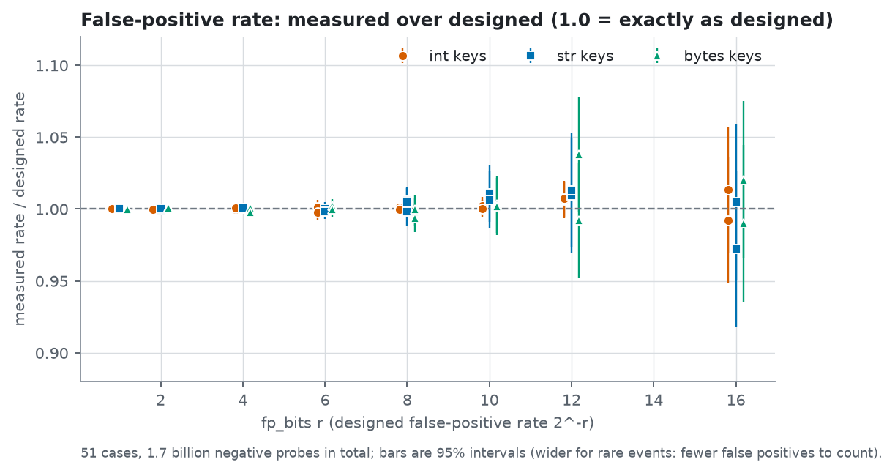

# Usage

The scripts in `examples/` show everything on this page running. Start with the first one.

## Examples

Start with `01_quickstart.py` and read them in order. Each script in [`examples/`](https://github.com/Zikithezikit/pyribbon/tree/main/examples) runs on its own
(`python examples/01_quickstart.py`), and `make example` runs them all.

| Script | What it shows |
|---|---|
| [01_quickstart.py](../examples/01_quickstart.py) | Build a filter, ask it about keys, look at its size |
| [02_key_types.py](../examples/02_key_types.py) | Which keys are accepted and how `b"a"`, `"a"` and `97` stay different |
| [03_choosing_fp_bits.py](../examples/03_choosing_fp_bits.py) | Designed against measured false-positive rate, and the cost in bits |
| [04_save_and_load.py](../examples/04_save_and_load.py) | `to_bytes`, loading from a memory-mapped file, and a damaged file |
| [05_batches_and_arrays.py](../examples/05_batches_and_arrays.py) | `contains_many` with lists, `array.array` and numpy |
| [06_errors.py](../examples/06_errors.py) | Every error a caller can get, and what causes it |
| [07_threads.py](../examples/07_threads.py) | Querying one filter from several threads |

## Using a filter

### Keys

A key can be `bytes`, `bytearray` or `memoryview` (hashed by content), `str` (as UTF-8) or `int` (any size; `numpy`
integers work). `b"a"`, `"a"` and `97` are three different keys. Anything else, such as a `float`, `None` or a tuple,
raises `TypeError`, because there is no implicit `str()`. Python's `hash()` is never used, so a saved filter can be loaded
in any process on any platform. [DESIGN.md](../DESIGN.md) (section 3.1) specifies the exact mapping. [examples/02_key_types.py](../examples/02_key_types.py) tries each case.

### Choosing `fp_bits`

The false-positive rate is `2**-fp_bits`, with `fp_bits` from 1 to 32 (default 8). The table below was measured on this
project's test machine at 1,000,000 keys and includes the 64-byte header. A Bloom filter needs `1.44 * fp_bits` bits per
key.

| `fp_bits` | false-positive rate | bits per key |
|---:|---:|---:|
| 4 | 6.25% | 4.50 |
| 8 | 0.39% | 8.99 |
| 12 | 0.024% | 13.49 |
| 16 | 0.0015% | 17.99 |
| 20 | 0.000095% | 22.48 |

The measured false-positive rate matches the designed one. Each dot below is one test case (int, `str` and `bytes` keys,
`fp_bits` 1 to 16, up to 100 million negative probes each); [measurements.md](measurements.md) lists them all.

[examples/03_choosing_fp_bits.py](../examples/03_choosing_fp_bits.py) measures the rate and the size for a few values of `fp_bits` on
your own machine.

### Saving and loading

`to_bytes()` produces a versioned, little-endian format with a magic number and checksums. `from_buffer()` queries the
bytes where they are, without copying them, so a memory-mapped file uses no memory beyond the pages you touch. The whole
round trip, including a memory-mapped file and a damaged one, is in
[examples/04_save_and_load.py](../examples/04_save_and_load.py).

`from_buffer(buf, verify=False)` skips the payload checksum, which would read every byte, so a huge mapped file stays
lazy. The header is always validated. The loader treats its input as untrusted: a truncated, corrupted or hostile buffer
raises `FormatError` (a `ValueError`) and is never read outside its bounds. The checksum detects accidental corruption
only. It is not a MAC, so it does not protect against tampering. Do not modify a buffer while a filter is using it.

### Batches and arrays

`contains_many(keys)` returns a `list[bool]`. A 1-D integer buffer (`array.array`, `numpy`) is hashed in C without the
GIL, and gives exactly the same results as querying the same ints one at a time. [examples/05_batches_and_arrays.py](../examples/05_batches_and_arrays.py) shows both, with and without numpy.

### Errors

A build that finds no solvable system after `max_attempts` seeds raises `ConstructionError`; it never returns a broken
filter. Bad serialized data raises `FormatError`. Both are subclasses of `RibbonError`. Invalid arguments raise
`ValueError` or `TypeError`.

[examples/06_errors.py](../examples/06_errors.py) triggers each of them.

### Threads

A filter is immutable, so any number of threads can query the same filter at once. Builds and large batches release the
GIL. `pickle` and `copy` work. The free-threaded builds of CPython (3.14t and 3.15t) have their own wheels, and importing
the extension there leaves the GIL off. [examples/07_threads.py](../examples/07_threads.py) queries one
filter from eight threads.
